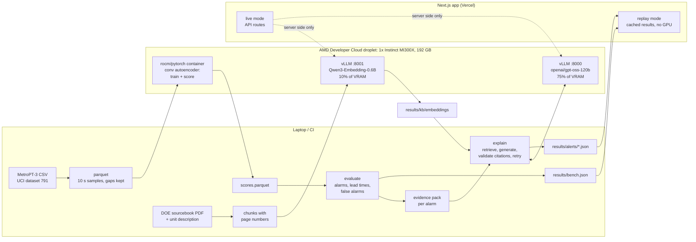

# Faultline

A predictive-maintenance copilot for an industrial air compressor, built for the
AMD Developer Hackathon: ACT III (Intelligent Industry track).

Faultline replays seven months of real sensor data from the air production unit
of a Porto metro train (the MetroPT-3 dataset, with four reported air-leak
failures), raises an alarm when the compressor starts behaving abnormally, and
for each alarm has an open LLM explain the likely cause with citations to a
maintenance manual and draft a work order for a technician. The anomaly detector
trains in PyTorch on ROCm and the LLM and embedding model are served by vLLM, all
on one AMD Instinct MI300X.

**Demo:** https://faultline-liart.vercel.app (replay mode: cached results, no GPU
behind it, so it keeps working after the droplet is gone)

<!-- status:start -->
> **Status:** the detector numbers below come from a run on `mps` (a local development run, not yet the MI300X) (finished 2026-10-13T07:53:32Z). `scripts/gpu_session.sh` reruns the same pipeline on the droplet and replaces them.
> The explanations, work orders, tokens per second and cost per alert are produced on the MI300X and are not in `results/` yet.
<!-- status:end -->

## The problem

A compressed air leak can run for hours without tripping a conventional alarm.
Pressure stays in range, motor current stays in range, oil temperature climbs
but stays under the limit a plant would set from past operation. What changes
is the pattern: the compressor stops cycling and runs under load without a
break, until someone notices or it fails. On a train, the air production unit
has no backup, so a failure takes the vehicle out of service.

Two things are missing in a plant that only has level alarms: something that
notices the pattern, and something that tells the technician who gets the alert
what it probably means and what to check, with a reference they can trust.

## What Faultline does

1. **Detects.** A 1D-convolutional autoencoder learns what 32 minutes of normal
   operation look like across the seven analog signals. Its reconstruction error
   on the newest 8 minutes is the anomaly score; an alarm fires when the score
   stays above a threshold for a minimum time. The model, the threshold and the
   duration are all fitted on data from before the first failure.
2. **Explains.** For each alarm an evidence pack is computed from the data: the
   signals that drove the alarm with their values against their normal ranges,
   the compressor duty cycle, the on/off signals. gpt-oss-120b gets the pack and
   the most relevant excerpts of the US DOE compressed air sourcebook and returns
   structured JSON: summary, likely causes, recommended actions, citations.
   Any answer whose citations are not word-for-word in the retrieved excerpts is
   rejected and retried.
3. **Drafts the work order.** Asset, symptom, suspected cause, steps, parts to
   check, priority. The technician can edit and approve it, and ask follow-up
   questions in a chat that uses the same evidence and retrieval.
4. **Shows its work.** The app replays the sensor stream with alarms appearing
   as they would have, and a benchmark page compares the detector with
   static-threshold alarms on the four real failures.

## Results

<!-- headline:start -->
| | Failures detected | First alarm vs start of reported window | False alarms per week |
|---|---|---|---|
| Faultline (conv autoencoder) | 4 of 4 | F1 86 min after; F2 16 min after; F3 21 min after; F4 98 min before | 0.90 |
| Static thresholds, tuned like the detector | 4 of 4 | F1 44 min after; F2 5 min after; F3 9 min after; F4 7.6 h before | 1.13 |
| Static thresholds at the pre-failure envelope | 1 of 4 | F1 missed; F2 missed; F3 missed; F4 4 min after | 0.00 |

False alarms are counted over the 17.8 weeks after the first failure that the tuning never saw. Where the operator recorded a maintenance time, Faultline's first alarm came this long before it: F3: 77.7 h, F4: 11.1 h.
<!-- headline:end -->

"Static thresholds, tuned like the detector" are three level alarms (oil
temperature, motor current, reservoir pressure drop rate) whose thresholds and
on-delays were chosen by the same procedure and on the same pre-failure data as
the detector's. "At the pre-failure envelope" places each limit at the most
extreme value seen before the first failure, the conventional way to set a
level alarm. Read the two together: against conventional limits the detector
catches failures they miss; a threshold rule tuned with the same care is
comparable to it, and the table shows where each one is ahead. The full report,
including the settings chosen, the protocol, each rule on its own and a
sensitivity analysis, is in [results/bench.md](results/bench.md).

<!-- bench:start -->
### First alarm relative to the start of each reported failure window

| Failure | Reported window (2020) | Faultline (conv autoencoder) | Static thresholds, tuned like the detector | Static thresholds at the pre-failure envelope |
|---|---|---|---|---|
| F1 (air leak) | 04-18 00:00 to 04-18 23:59 | 86 min after | 44 min after | missed |
| F2 (air leak) | 05-29 23:30 to 05-30 06:00 | 16 min after | 5 min after | missed |
| F3 (air leak) | 06-05 10:00 to 06-07 14:30 | 21 min after | 9 min after | missed |
| F4 (air leak) | 07-15 14:30 to 07-15 19:00 | 98 min before | 7.6 h before | 4 min after |

### Warning before the reported maintenance

| Failure | Maintenance | Faultline (conv autoencoder) | Static thresholds, tuned like the detector | Static thresholds at the pre-failure envelope |
|---|---|---|---|---|
| F3 | 06-08 16:00 | 77.7 h | 77.9 h | n/a |
| F4 | 07-16 00:00 | 11.1 h | 17.1 h | 9.4 h |

### Detection and false alarms

| | Faultline (conv autoencoder) | Static thresholds, tuned like the detector | Static thresholds at the pre-failure envelope |
|---|---|---|---|
| Failures detected (of 4) | 4 | 4 | 1 |
| Detected before the window start | 1 | 1 | 0 |
| False alarms | 16 | 20 | 0 |
| False alarms per week | 0.90 | 1.13 | 0.00 |
| False alarms per week of logged data | 1.11 | 1.39 | 0.00 |
| False alarms during sustained compressor load | 8 | 10 | 0 |
| Alarms in the tuning period | 9 | 12 | 0 |

False alarms are counted from 2020-04-18 to 2020-09-01, outside the failure spans: 17.8 calendar weeks, 14.4 weeks of logged data. "During sustained compressor load" counts false alarms that fired while the compressor had been under load for more than 20 minutes without a break, the same behaviour as in the reported failures, on days with no failure report.
<!-- bench:end -->

### Second test: MetroPT-2

MetroPT-2 is a later recording from the same operator (April to July 2022, a
different failure history: one air leak and one oil leak). Nothing about the
detector, the baselines or the tuning procedure was chosen with it. The same
code was pointed at it afterwards, trained and tuned on its own data from before
its first failure, with every setting left as it was for MetroPT-3.

<!-- metropt2:start -->
| | F1 (air leak, 2022-06-04) | F2 (oil leak, 2022-07-11) | False alarms | False alarms per week |
|---|---|---|---|---|
| Faultline (conv autoencoder) | 51 min after | 48 min after | 3 | 0.44 |
| Static thresholds, tuned like the detector | 39 min after | 41.8 h after | 0 | 0.00 |
| Static thresholds at the pre-failure envelope | 32 min after | 55.4 h after | 0 | 0.00 |

First alarm against the start of each reported window; false alarms counted over the 6.8 weeks after the first failure. Trained on `mps` in a local development run on 2026-10-13, on MetroPT-2 data from before 2022-06-04 10:19 only. Full report: [results/metropt2/bench.md](results/metropt2/bench.md).
<!-- metropt2:end -->

### Detector training

<!-- training:start -->
Trained on `mps` (a local development run, not yet the MI300X). 5 cross-fitting folds plus the final model took 1613 s (278 s for the final model); 89,047 parameters, 20 epochs, windows of 192 samples (32 min). Scoring ran at 178,643 windows per second.
<!-- training:end -->

### LLM on the MI300X

<!-- llm:start -->
Not measured yet. These figures are written to `results/llm/summary.json` by `python -m faultline.explain` when the droplet is up.
<!-- llm:end -->

Everything between the HTML comment markers in this file is written by
`python -m faultline.report` from the files in `results/`. A test fails if it
goes stale.

## Architecture



## How AMD is used

Everything that computes runs on one AMD Instinct MI300X (192 GB), an AMD
Developer Cloud GPU droplet. There is no hosted LLM API anywhere in the code:
the only model endpoints are `LLM_URL` and `EMBED_URL`, which point at the
droplet.

| What | How |
|---|---|
| Detector training and scoring | PyTorch on ROCm inside the `rocm/pytorch` container. `torch.cuda.is_available()` is true on ROCm; the run records `torch.version.hip` and the GPU name in `results/train.json`. Five cross-fitted models plus the final model. |
| Explanations, work orders, chat | `openai/gpt-oss-120b` served by vLLM (`vllm/vllm-openai-rocm:v0.31.0`) on port 8000 with `--gpu-memory-utilization 0.75`, `--attention-backend ROCM_AITER_UNIFIED_ATTN`, `--reasoning-parser openai_gptoss` and `VLLM_ROCM_USE_AITER=1`. Structured output through `response_format: json_schema`. |
| Retrieval | `Qwen/Qwen3-Embedding-0.6B` served by a second vLLM on port 8001 with `--runner pooling --gpu-memory-utilization 0.10`. Both manual chunks and queries are embedded there. |
| GPU memory split | 75% LLM, 10% embedder, the rest left free for training and scoring. Measured usage with both servers up is saved to `results/gpu/serving_vram.txt`. |

The droplet is driven entirely by scripts over SSH, so it can be destroyed and
rebuilt at any time:

| Script | What it does |
|---|---|
| `scripts/gpu_session.sh` | The whole GPU session in order, from a fresh droplet to finished results. |
| `scripts/remote_train.sh` | Sync code and data, train in the ROCm container, pull the scores back, evaluate. |
| `scripts/remote_setup.sh` | Start both vLLM servers, wait until healthy, print GPU memory. |
| `scripts/smoke.py` | From the laptop: `/v1/models`, one chat completion, one embedding. |
| `scripts/remote_teardown.sh` | Stop the servers. Billing only stops when the droplet is destroyed. |

A note on the vLLM flags: AMD's day-0 guide for gpt-oss on MI300X sets
`VLLM_USE_AITER_UNIFIED_ATTENTION=1` and `VLLM_ROCM_USE_AITER_MHA=0`. Current
vLLM replaced those with `--attention-backend ROCM_AITER_UNIFIED_ATTN`, which is
what the vLLM recipe for gpt-oss-120b on MI300X and AMD's ROCm vLLM guide now
use, so the scripts follow that.

## Quickstart

### Replay mode (no GPU)

Replay mode serves the cached results in `results/`. It needs Node 22 or newer
and pnpm.

```bash
git clone https://github.com/saahilshah178/faultline_amd.git
cd faultline_amd/apps/web
pnpm install
pnpm dev          # http://localhost:3000
```

`pnpm dev` and `pnpm build` first copy what the app needs from `results/` and
`prompts/` into the app (`scripts/sync-data.mjs`). The pages are built from that
data, so after regenerating results, rebuild. Tests: `pnpm test` (unit) and
`pnpm test:e2e` (Playwright: replays through a failure, and exercises live mode
against a local mock of the vLLM servers).

### Rebuild the results (GPU)

Needs Python 3.12 with [uv](https://docs.astral.sh/uv/), and an AMD Developer
Cloud droplet with one MI300X.

```bash
uv sync --extra train
uv run python -m faultline.data      # download MetroPT-3, write data/metropt3.parquet
uv run python -m faultline.profile   # normal operating profile, unit description
uv run python -m faultline.kb        # download the DOE sourcebook, chunk it

cp .env.example .env                 # set DROPLET_HOST and VLLM_API_KEY
scripts/gpu_session.sh               # train, serve, embed, explain
```

When it finishes, commit `results/` and destroy the droplet. A powered-off
droplet still bills.

### Live mode

With the droplet up, the app's API routes call it for chat and for regenerating
an explanation. The browser never talks to the droplet.

```bash
cd apps/web
FAULTLINE_MODE=live \
LLM_URL=http://<droplet-ip>:8000/v1 EMBED_URL=http://<droplet-ip>:8001/v1 \
VLLM_API_KEY=<key> pnpm dev
```

The deployed app is a Vercel project with its root directory set to `apps/web`,
connected to this repository, so a push to `main` redeploys it. To switch the
deployment to live mode while the droplet is up, set the same four variables
and redeploy; remove `FAULTLINE_MODE` (or set it to `replay`) and redeploy
before destroying the droplet.

```bash
vercel env add FAULTLINE_MODE production     # live
vercel env add LLM_URL production            # http://<droplet-ip>:8000/v1
vercel env add EMBED_URL production          # http://<droplet-ip>:8001/v1
vercel env add VLLM_API_KEY production
vercel deploy --prod
```

In live mode anyone with the URL can make the droplet do work, so leave it on
only while someone is demonstrating it.

### Check the benchmark

```bash
uv run python -m faultline.evaluate --check   # recompute from saved scores, compare with bench.json
scripts/reproduce.sh                           # retrain from scratch, then compare
uv run pytest                                  # includes the guard that tuning never sees failure data
```

## How the evaluation works

- **No failure data in fitting.** The scaler, the model weights, the alarm
  threshold and the alarm duration are computed by code that refuses any
  timestamp on or after 2020-04-18 00:00, the start of the first reported
  failure (`assert_pre_failure`; there is a test for it).
- **Cross-fitted thresholds.** Scores for the pre-failure period come from
  models that did not train on the block being scored, so the threshold is not
  flattered by in-sample fit.
- **The pre-failure data is not clean.** It contains episodes where the
  compressor ran under load far longer than a normal cycle and nobody filed a
  report. They are left out of the detector's training set, and every method,
  detector and baseline alike, is tuned to catch them early while raising at
  most two alarms elsewhere before the first failure.
- **Detection and false alarms.** A failure is detected if an alarm fires from
  24 hours before its reported window until the window ends or the reported
  maintenance. Alarms anywhere else are false alarms, counted over the period
  after the first failure.

## Limitations

- **Four failures.** All four are air leaks on one machine. The second test adds
  one air leak and one oil leak from a later recording. Nothing here is a rate,
  and one oil leak says little about other fault types.
- **The reported windows open late.** In the data, each window starts within
  minutes of the compressor going into continuous load, when the leak is already
  in full effect. Lead time against the window start is therefore mostly a
  measure of how fast a method reacts, not of early warning. Lead time against
  the recorded maintenance is the more useful figure, and only two failures
  have one.
- **False alarms are judged against failure reports, not against the truth.**
  Some of the alarms counted as false fired during sustained compressor load on
  days with no report (the results table counts them). Whether those were real
  leaks that went unreported cannot be settled from this dataset.
- **The detector was revised once after its first full evaluation.** The first
  version trained on all pre-failure data and missed most of the unreported
  sustained-load episodes in it. Leaving those episodes out of training uses
  pre-failure data only, but the decision came after seeing a full evaluation.
  The first run is kept in [results/history](results/history/README.md).
- **A tuned static rule is comparable.** On these four leaks a simple
  oil-temperature or motor-current rule, tuned with the same procedure, is in
  the same range as the autoencoder; the results table has the comparison. The
  tuning procedure defines its proxy anomalies from motor current, which helps
  that rule. What the detector adds is over the limits a plant would
  conventionally set, and in not needing to be told which signal to watch.
- **The detector is blind after a gap.** It needs 32 minutes of unbroken data
  before it can score.
- **Explanations are generated, then checked, not verified.** Citation
  validation guarantees that every quoted passage exists on the cited page of
  the manual. It does not guarantee the diagnosis is right. The work order is a
  draft for a technician to review.

## Repository layout

```
faultline/        the pipeline (data, detector, alarms, baseline, evaluate, kb, evidence, explain)
scripts/          droplet scripts and the smoke test
prompts/          prompts and JSON schemas, shared by the pipeline and the app's live mode
apps/web/         the Next.js app
Dockerfile        the app as a container (docker build -t faultline . && docker run -p 3000:3000 faultline)
results/          everything the app and this README show: bench, alerts, replay data, EDA plots
data/             failures.csv and provenance notes; the dataset itself is downloaded
docs/             unit description, submission notes
tests/            pytest suite
```

## Data and licences

- **MetroPT-3** (Davari, Veloso, Ribeiro, Gama; UCI Machine Learning Repository,
  dataset 791, [doi:10.24432/C5VW3R](https://doi.org/10.24432/C5VW3R)), CC BY 4.0.
  Downloaded by `faultline.data`, not redistributed here in raw form.
  `results/replay/` holds one-minute averages derived from it. The failure table
  comes from the dataset's own description; see [data/README.md](data/README.md)
  for provenance and for what the sources disagree on.
- **Improving Compressed Air System Performance: A Sourcebook for Industry**,
  third edition, U.S. Department of Energy with the Compressed Air Challenge.
  [PDF](https://www.energy.gov/sites/prod/files/2016/03/f30/Improving%20Compressed%20Air%20Sourcebook%20version%203.pdf).
  Downloaded by `faultline.kb`; `results/kb/chunks.json` holds the text excerpts
  the explainer retrieves and cites.
- Code: MIT, see [LICENSE](LICENSE).
